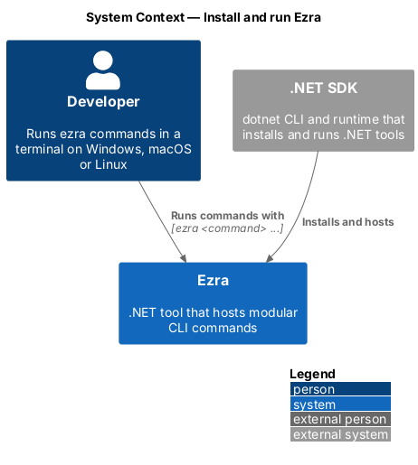
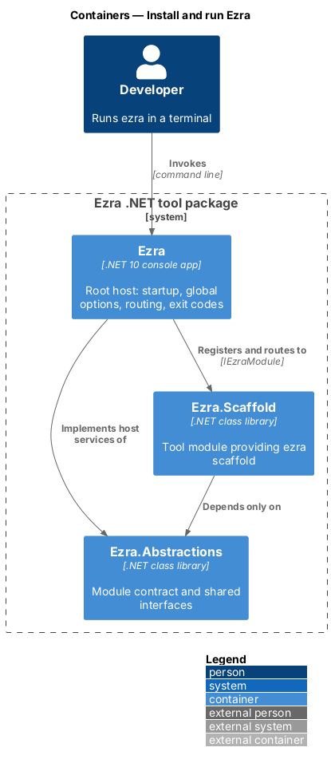
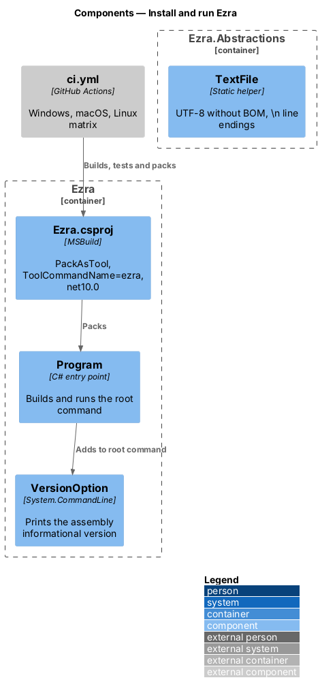
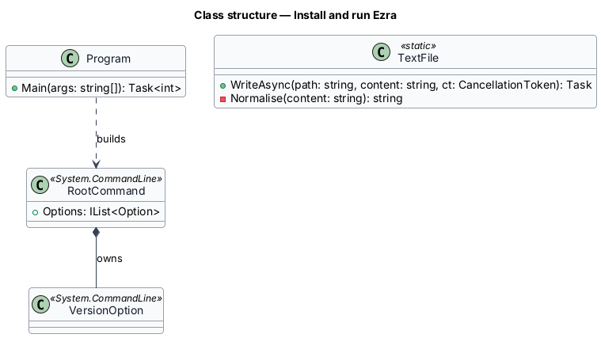
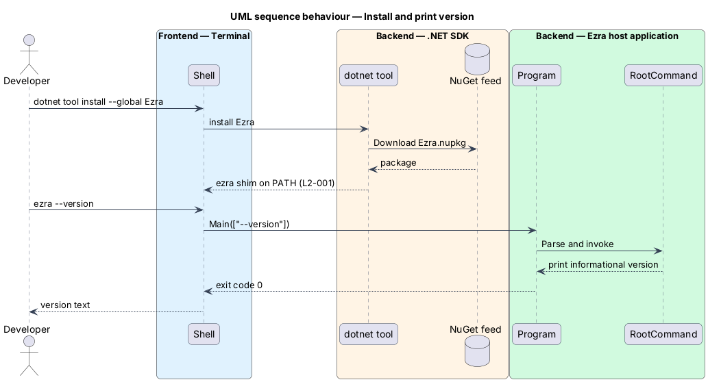

# Install and run Ezra

## Overview

Ezra is a command-line tool for .NET developers. A *.NET tool* is a console application packed as a NuGet package that the `dotnet` CLI installs and puts on the PATH. Ezra ships as one such package, `Ezra`, whose command is `ezra`.

This feature covers how Ezra is built, packed, installed, updated and versioned, and the conventions that keep it behaving the same on Windows, macOS and Linux. Every other feature depends on it: a command that cannot be installed, or that behaves differently per platform, does not meet L1-001.

- **global tool** — .NET tool installed once per user with `dotnet tool install --global`
- **local tool** — .NET tool pinned in a repository's `.config/dotnet-tools.json` manifest and run with `dotnet ezra`

## Description

- **`src/Ezra/Ezra.csproj`** — the packed project. It sets `OutputType` to `Exe`, `TargetFramework` to `net10.0`, `PackAsTool` to `true`, `ToolCommandName` to `ezra` and `PackageId` to `Ezra`. It references every `Ezra.<Tool>` project, so all tool assemblies ship inside the one package.
- **`Directory.Build.props`** — repository-wide settings: `Nullable` enabled, `TreatWarningsAsErrors` enabled, and a single `Version` property that sets the package version.
- **`VersionOption`** — the built-in `--version` option of the `System.CommandLine` root command. It prints the informational version of the `Ezra` assembly and returns exit code `0`.
- **`TextFile`** — static helper in `Ezra.Abstractions`. `TextFile.WriteAsync(path, content, ct)` normalises line endings to `\n` and writes UTF-8 without a byte-order mark. Every module writes generated text through it (L2-002).
- **Path convention** — code builds paths only with `Path.Combine`, `Path.GetFullPath` and `Environment.GetFolderPath`. No code concatenates `/` or `\` into paths.
- **`.github/workflows/ci.yml`** — GitHub Actions workflow with a matrix of `ubuntu-latest`, `windows-latest` and `macos-latest`. Each leg restores, builds, runs `tests/Ezra.AcceptanceTests`, and packs the tool.
- **`PackagingTests`** — acceptance tests in `tests/Ezra.AcceptanceTests`. They pack `Ezra` to a temporary feed, install it with `dotnet tool install --tool-path <temp>` (and with a local manifest), run `ezra --version`, and assert the output and exit code.
- **Publishing** — the target NuGet feed and the release trigger are `<TO SUPPLY>`.

## Requirements

The feature realizes the following level-2 (L2) requirements. Each L2 requirement refines a level-1 (L1) requirement, cited by identifier.

| L2 ID | Refines (L1) | Requirement |
|-------|--------------|-------------|
| `L2-001` | `L1-001` | Ezra shall be packed as a NuGet package configured as a .NET tool whose command name is `ezra`, targeting the current .NET LTS runtime. |
| `L2-002` | `L1-001` | Ezra shall use no platform-specific APIs, shall build all file paths with platform-neutral path APIs, and its acceptance tests shall run in CI on Windows, macOS and Linux. |

## Diagrams

### System context

The developer installs Ezra through the .NET SDK and runs it from a terminal.

### Containers

One NuGet package carries the `Ezra` host and every tool library; the host is the only executable.

### Components

Inside the `Ezra` host, the project file defines the packaging and the root command supplies `--version`; `TextFile` in `Ezra.Abstractions` fixes text encoding.

### Class structure

`Program` builds the root command, which owns the `--version` option; `TextFile` is the single writer for generated text.

### Behaviour — install and print version

The .NET SDK installs the package and shims `ezra` onto the PATH; `ezra --version` prints the version and returns `0` (L2-001).

