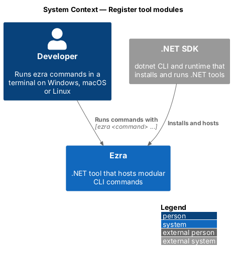
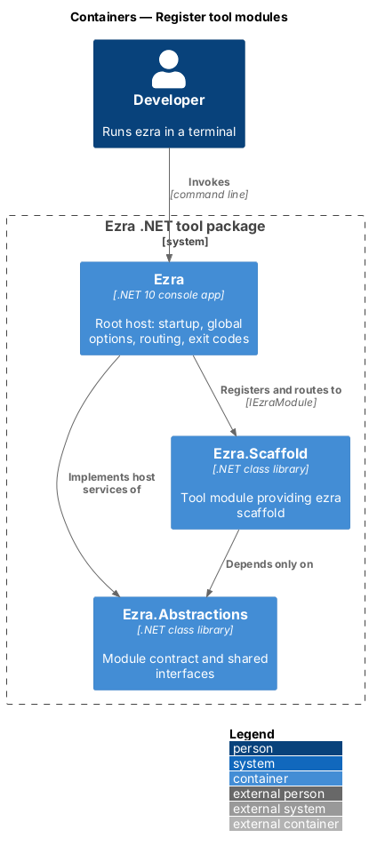
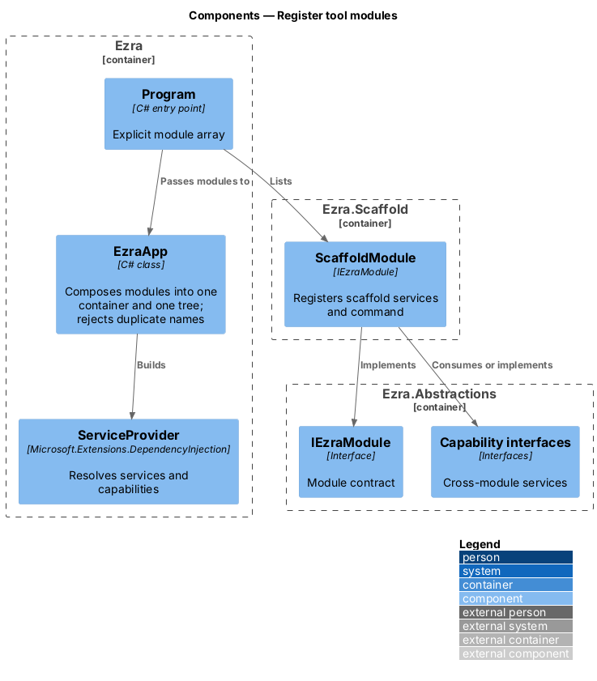
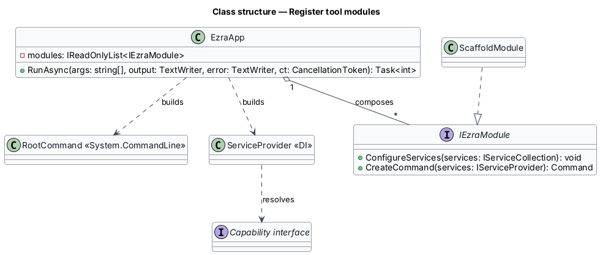
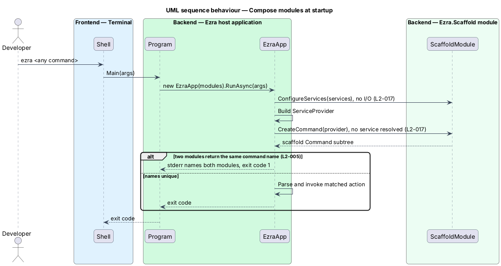
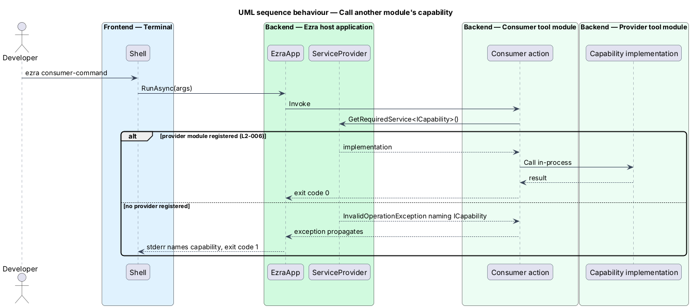

# Register tool modules

## Overview

Ezra stays maintainable at hundreds of commands by splitting them into *tool modules*.

- **tool module** — .NET class library named `Ezra.<Tool>` that contributes one top-level command and its services through the module contract
- **module contract** — `IEzraModule` interface in `Ezra.Abstractions` that every tool module implements
- **capability** — service interface published in `Ezra.Abstractions` that one module implements and another module consumes

The host composes modules; modules never see each other. Adding a tool is two edits in the host: a project reference and one registration line. This feature defines that contract, how the host builds one dependency-injection container from all modules, how one module calls another through a capability, and why startup cost stays flat as modules are added (L2-017).

## Description

- **`IEzraModule`** (`src/Ezra.Abstractions/IEzraModule.cs`) — the module contract.
  - `void ConfigureServices(IServiceCollection services)` — registers the module's services. It shall perform no I/O.
  - `Command CreateCommand(IServiceProvider services)` — builds the module's one top-level `System.CommandLine` command and its subcommands. Each action resolves its services from `services` only when invoked, so building the tree does no work beyond allocating command objects (L2-017).
- **`Program`** (`src/Ezra/Program.cs`) — holds the explicit array of modules, for example `new ScaffoldModule()`. Registration is explicit, not reflection-based, so startup does no assembly scanning.
- **`EzraApp`** (`src/Ezra/EzraApp.cs`) — `RunAsync(args, output, error, ct)` calls `ConfigureServices` on every module and builds one `ServiceProvider`. It then calls `CreateCommand` on every module and adds each command to the `RootCommand`. When two modules return a command with the same name, it writes `Modules <A> and <B> both declare the top-level command '<name>'.` to stderr and returns exit code `1` (L2-005 criterion 3). Otherwise it parses `args` and invokes the matched action.
- **Capabilities** — a capability is a service interface published in `Ezra.Abstractions`. The providing module registers its implementation in `ConfigureServices`. The consuming module resolves the interface with `GetRequiredService<T>()` from the shared container, in-process. When no module provides it, the resolution error names the interface and the exit code is `1` (L2-006 criterion 2); report-results replaces the stack trace with a one-line message.
- **Dependency rule** — each `Ezra.<Tool>.csproj` references only `Ezra.Abstractions` and external packages. Review enforces the rule; no test asserts project structure.
- **Capability example** — none exists yet. The first capability is introduced by the first tool that needs one.

## Requirements

The feature realizes the following level-2 (L2) requirements. Each L2 requirement refines a level-1 (L1) requirement, cited by identifier.

| L2 ID | Refines (L1) | Requirement |
|-------|--------------|-------------|
| `L2-005` | `L1-003` | Each tool shall be its own project and assembly named `Ezra.<Tool>` that implements one shared module contract defined in an `Ezra.Abstractions` project. Modules shall depend only on `Ezra.Abstractions` (and their own dependencies), never on each other or on the root host. |
| `L2-006` | `L1-003` | A command in one module shall be able to invoke a capability of another module only through a service interface published in `Ezra.Abstractions` (or a module-owned contracts package), never by referencing another module's implementation or by spawning `ezra` as a child process. |
| `L2-017` | `L1-007` | Commands shall be built so that startup cost does not grow with the number of registered commands: modules shall register commands without performing I/O or network calls, and handlers shall resolve their services only when invoked. |

## Diagrams

### System context

The developer sees one `ezra` command; the module split is internal to Ezra.

### Containers

The host references each tool module; tool modules reference only `Ezra.Abstractions`.

### Components

`EzraApp` reads the module list, rejects duplicate command names, and builds one service container that serves every module's handlers.

### Class structure

Modules implement `IEzraModule`; `EzraApp` composes them; a consumer module depends on a capability interface, never on the providing module.

### Behaviour — compose modules at startup

The host gathers every module's services into one container, builds the command tree without resolving any handler service, and rejects duplicate top-level names (L2-005, L2-017).

### Behaviour — call another module's capability

A consumer action resolves a capability interface through the shared container; a missing provider yields exit code `1` (L2-006).

