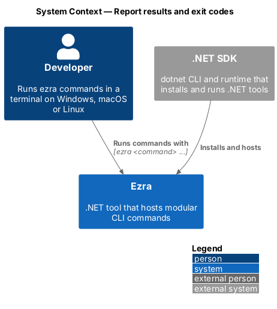
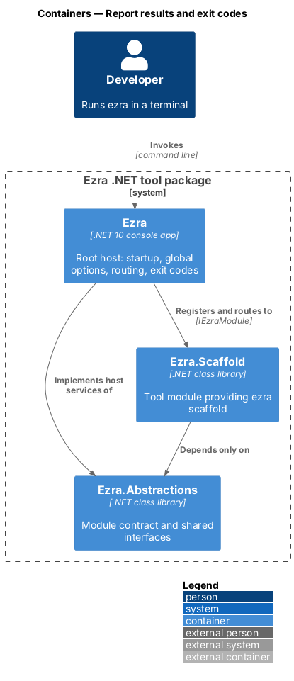
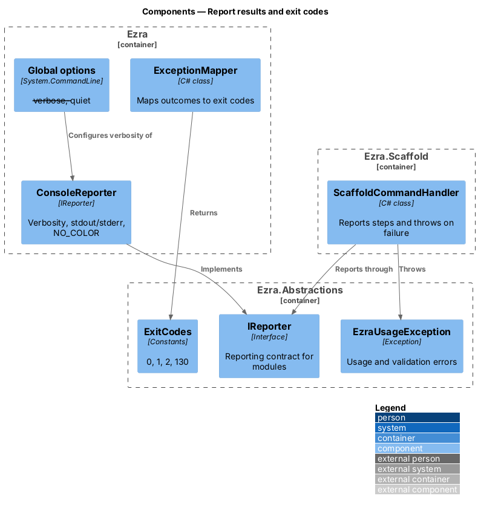
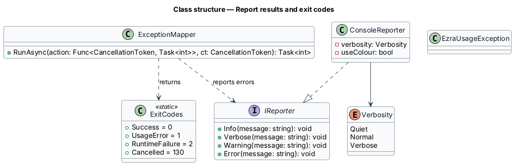
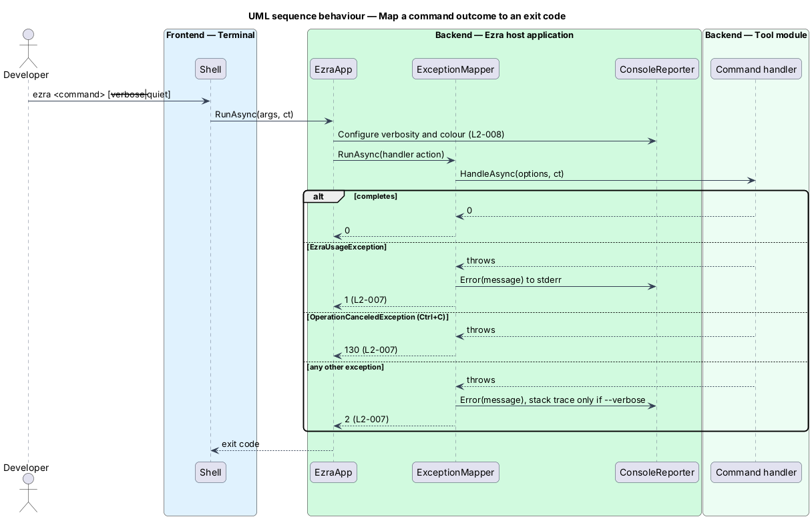

# Report results and exit codes

## Overview

Every Ezra command reports progress, warnings and errors the same way, and ends with one of four exit codes. Scripts and CI pipelines rely on these codes, so they are part of Ezra's contract (L1-004).

- **exit code** — integer a process returns to its caller: `0` success, `1` usage or validation error, `2` runtime failure, `130` cancelled
- **verbosity** — level of detail written to the terminal: `quiet` (errors only), `normal`, or `verbose` (each significant step)

Tool modules do not write to the console directly. They report through `IReporter` and signal failures with typed exceptions; the host turns both into terminal output and an exit code.

## Description

- **`ExitCodes`** (`Ezra.Abstractions`) — constants `Success = 0`, `UsageError = 1`, `RuntimeFailure = 2`, `Cancelled = 130`.
- **`EzraUsageException`** (`Ezra.Abstractions`) — thrown by handlers for invalid input that the parser cannot detect, for example an invalid project name. The host maps it to exit code `1`.
- **`IReporter`** (`Ezra.Abstractions`) — `Info(string)`, `Verbose(string)`, `Warning(string)`, `Error(string)`. Info and verbose lines go to stdout; warnings and errors go to stderr.
- **`ConsoleReporter`** (`src/Ezra`) — the single `IReporter` implementation. It suppresses `Info` under `--quiet`, writes `Verbose` only under `--verbose`, and writes ANSI colour only when stdout is a terminal (`Console.IsOutputRedirected` is false) and `NO_COLOR` is unset (L2-008).
- **Global options** — `--verbose` and `--quiet` are `Option<bool>` with `Recursive = true` on the root, so every command accepts them. A validator on the root rejects both together with exit code `1` (L2-008 criterion 4).
- **`ExceptionMapper`** (`src/Ezra`) — wraps every action. `EzraUsageException` → one-line error, exit `1`. `OperationCanceledException` → exit `130`. Any other exception → one-line error, stack trace only under `--verbose`, exit `2` (L2-007).
- **Cancellation** — `System.CommandLine` passes a `CancellationToken` that is cancelled on Ctrl+C. Handlers pass it to every async call.

## Requirements

The feature realizes the following level-2 (L2) requirements. Each L2 requirement refines a level-1 (L1) requirement, cited by identifier.

| L2 ID | Refines (L1) | Requirement |
|-------|--------------|-------------|
| `L2-007` | `L1-004` | All commands shall use the same exit codes: `0` success, `1` usage or validation error, `2` runtime failure, `130` cancelled by Ctrl+C. |
| `L2-008` | `L1-004` | Normal output shall go to stdout and errors to stderr. Every command shall accept the global options `--verbose` and `--quiet`. Colour shall be disabled when output is redirected or when `NO_COLOR` is set. |

## Diagrams

### System context

The developer, or a script, reads Ezra's stdout, stderr and exit code.

### Containers

Tool modules report through `Ezra.Abstractions` interfaces; the host owns the console.

### Components

`ExceptionMapper` turns handler outcomes into exit codes, and `ConsoleReporter` applies verbosity and colour rules.

### Class structure

`ConsoleReporter` implements `IReporter`; `ExceptionMapper` maps the `EzraUsageException` family, cancellation and other exceptions to `ExitCodes`.

### Behaviour — map a command outcome to an exit code

Each handler outcome passes through `ExceptionMapper`, which writes at most one error line and returns the exit code L2-007 assigns.

