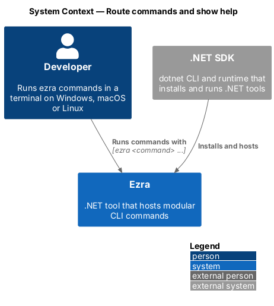
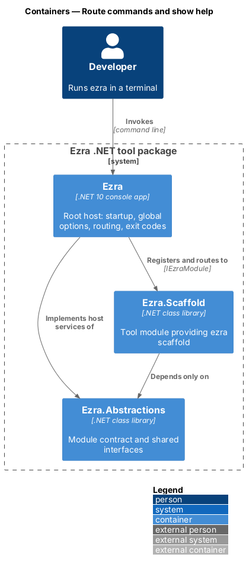
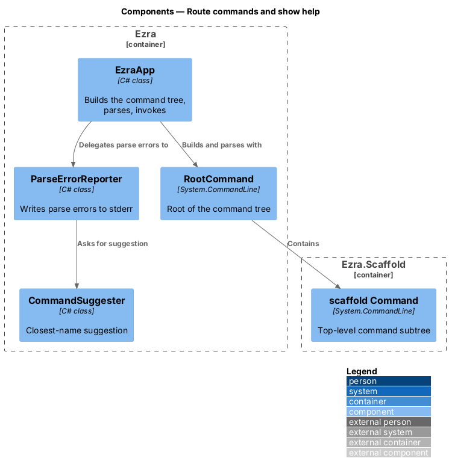
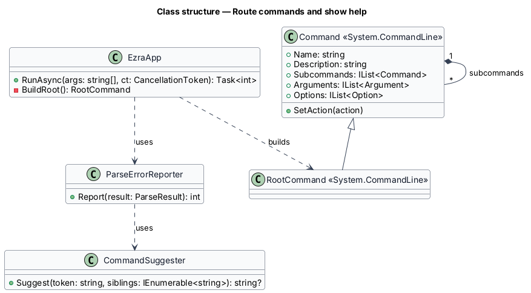
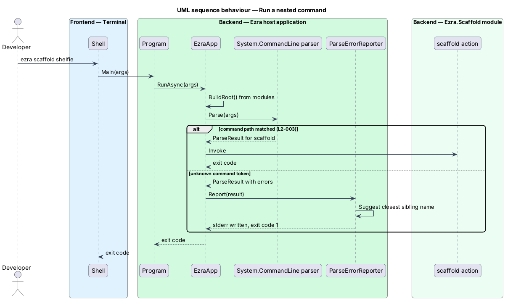
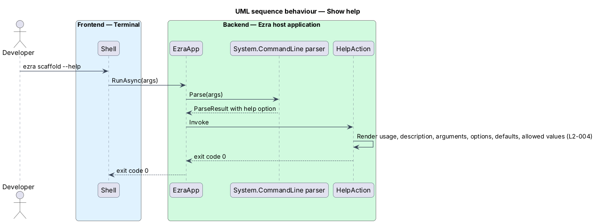

# Route commands and show help

## Overview

Ezra is expected to grow to hundreds of commands. To keep them discoverable, commands form a tree under the `ezra` root, in the style of `dotnet ef migrations add`.

- **command tree** — hierarchy of commands rooted at `ezra`, where each node is a command and its children are its subcommands
- **top-level command** — direct child of the root, owned by exactly one tool module (for example `scaffold`)
- **command path** — sequence of command names from the root to one command, for example `scaffold`

This feature parses the command line, finds the command the path names, runs its handler, and generates help and error messages from what each command declares. All parsing goes through `System.CommandLine` 2.0, the single parsing library L2-003 calls for.

## Description

- **`EzraApp`** — host class in `src/Ezra`. `RunAsync(args, ct)` builds the `RootCommand` from the registered modules (see register-tool-modules), parses `args` with `System.CommandLine`, and invokes the matched command's action.
- **`RootCommand`** — the `System.CommandLine` root. With no subcommand given, its action prints the list of top-level commands with their descriptions and returns `0` (L2-003 criterion 2).
- **Subcommand nesting** — each tool returns one `Command`. A tool adds subcommands with `Command.Subcommands.Add`, to any depth. The parser walks the tree; the host adds no routing code of its own.
- **Declared metadata** — every `Command`, `Argument<T>` and `Option<T>` carries a `Description`. Options declare `DefaultValueFactory` for defaults and `AcceptOnlyFromAmong(...)` for allowed values. `System.CommandLine` renders `-h` / `--help` from this metadata, which lists defaults and allowed values (L2-004).
- **`CommandSuggester`** — host class. On an unrecognised command token it computes the Levenshtein distance to each sibling command name and returns the closest name within distance 2, or none.
- **`ParseErrorReporter`** — host class. It writes each parse error, plus the suggestion from `CommandSuggester` (`Did you mean 'scaffold'?`), to stderr and returns exit code `1`.

## Requirements

The feature realizes the following level-2 (L2) requirements. Each L2 requirement refines a level-1 (L1) requirement, cited by identifier.

| L2 ID | Refines (L1) | Requirement |
|-------|--------------|-------------|
| `L2-003` | `L1-002` | The `ezra` root command shall host top-level commands (for example `scaffold`), each of which may host further subcommands to any depth. Commands, options and arguments shall be parsed with a single shared command-line parsing library. |
| `L2-004` | `L1-002` | Every command and subcommand shall provide help generated from its declared description, arguments and options. |

## Diagrams

### System context

The developer types a command path; Ezra resolves it and either runs it or explains what went wrong.

### Containers

Routing lives entirely in the `Ezra` host; tool modules only contribute command subtrees.

### Components

`EzraApp` assembles the tree, `System.CommandLine` parses it, and the host's error reporter adds suggestions for unknown commands.

### Class structure

Each `IEzraModule` contributes one `Command`; commands nest through `Subcommands`; `ParseErrorReporter` uses `CommandSuggester`.

### Behaviour — run a nested command

The parser matches the command path and runs the leaf command's action; an unknown token is reported with a suggestion and exit code `1` (L2-003).

### Behaviour — show help

`--help` at any command path short-circuits the action and renders help from the declared metadata (L2-004).

