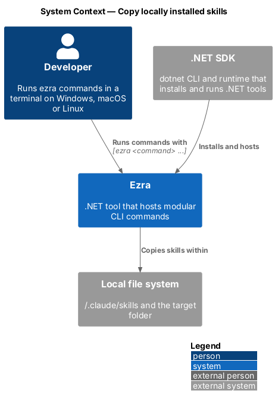
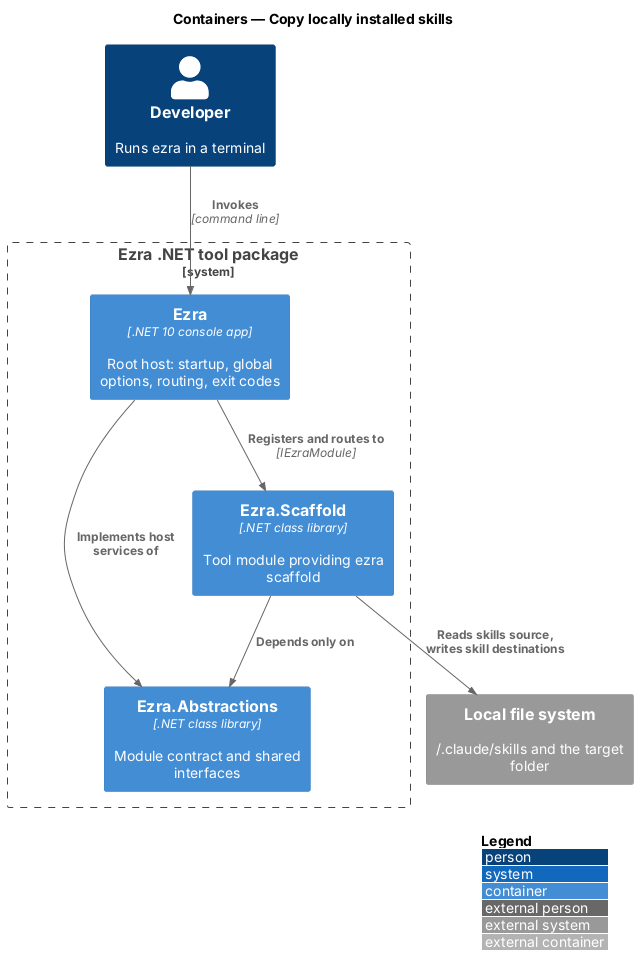
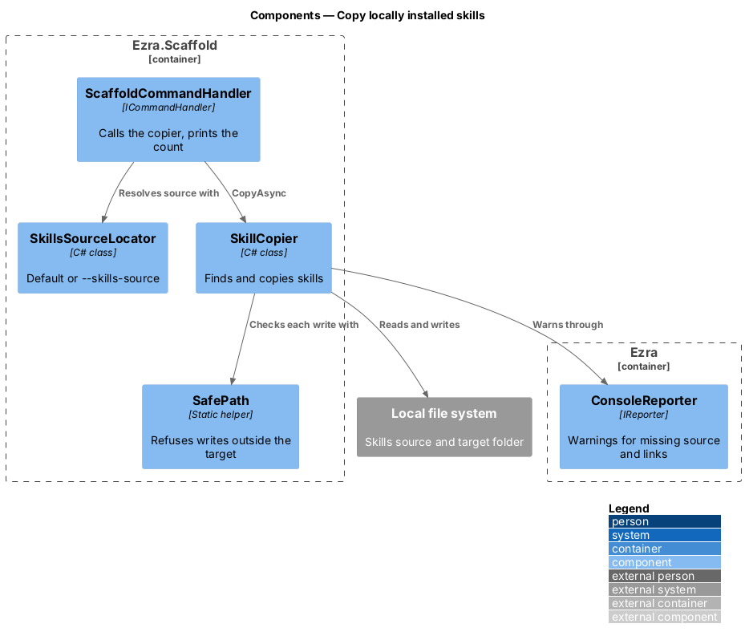
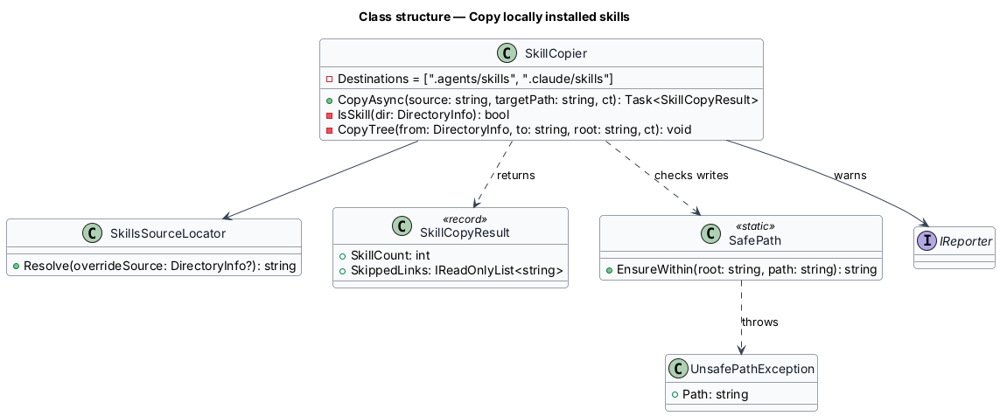
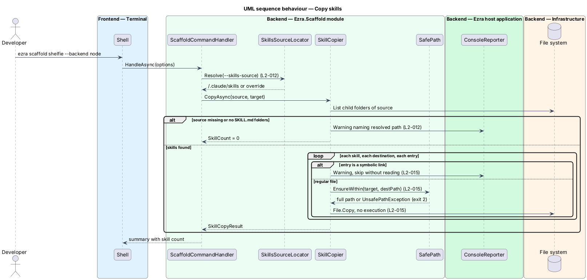

# Copy locally installed skills

## Overview

A *skill* is a folder of instructions and supporting files that an AI coding agent loads for a specific kind of task. Each skill folder holds a `SKILL.md` at its root. Developers install skills once in a user-level folder; the scaffold copies them into each new project so every agent working on the project has them.

- **skills source** — folder the scaffold reads skills from: `~/.claude/skills` by default (`%USERPROFILE%\\.claude\\skills` on Windows), or the folder named by `--skills-source`
- **skill destinations** — `.agents/skills/` and `.claude/skills/` in the target folder; both receive identical copies

The copy is a plain byte-for-byte file copy. It never follows symbolic links, never writes outside the target folder, and never runs anything it copies.

## Description

- **`SkillsSourceLocator`** — `Resolve(DirectoryInfo? overrideSource)`. It returns the override when given, otherwise `Path.Combine(Environment.GetFolderPath(SpecialFolder.UserProfile), ".claude", "skills")`.
- **`SkillCopier`** — `CopyAsync(source, targetPath, ct)` returns a `SkillCopyResult`.
  - If the source does not exist or has no skills, it reports a warning naming the resolved path and returns a count of `0`. The scaffold still succeeds (L2-012 criterion 3).
  - A skill is a direct child folder of the source that contains `SKILL.md`. Other folders are skipped.
  - For each skill and each destination, it deletes any existing copy of that skill folder (relevant only under `--force`), then copies every file recursively with `File.Copy`.
  - It honours the `CancellationToken` between files.
- **Symbolic links** — before reading an entry, `SkillCopier` checks `FileSystemInfo.LinkTarget`. A non-null value marks a link; the copier reports a warning naming it and skips it without reading the target (L2-015 criterion 1).
- **`SafePath.EnsureWithin(root, path)`** — computes `Path.GetFullPath(path)` and throws `UnsafePathException` when the result is not inside `root`. `SkillCopier` calls it before every write; the host maps the exception to exit code `2` (L2-015 criterion 2).
- **No execution** — the copier only calls `File.Copy`. It sets no execute permissions beyond those the source file already has, and starts no processes (L2-015 criterion 3).
- **`SkillCopyResult`** — record with `SkillCount` and the list of skipped links. The handler prints the count in its summary.
- **Performance** — a source of 50 skills totalling 10 MB copies in under 2 seconds on a CI runner (L2-017 criterion 2). Sequential `File.Copy` is the design; parallel copy is not needed at that size.

## Requirements

The feature realizes the following level-2 (L2) requirements. Each L2 requirement refines a level-1 (L1) requirement, cited by identifier.

| L2 ID | Refines (L1) | Requirement |
|-------|--------------|-------------|
| `L2-012` | `L1-005` | The scaffold shall copy every skill (a folder containing a `SKILL.md`) from the skills source into both `.agents/skills/` and `.claude/skills/` of the new project, preserving folder structure and file contents. The default skills source is `~/.claude/skills`; `--skills-source` overrides it. |
| `L2-015` | `L1-006` | When copying skills, Ezra shall not follow symbolic links, shall not write any file whose resolved path falls outside the target project folder, and shall never execute copied files. |
| `L2-017` | `L1-007` | Commands shall be built so that startup cost does not grow with the number of registered commands: modules shall register commands without performing I/O or network calls, and handlers shall resolve their services only when invoked. |

## Diagrams

### System context

The scaffold reads skills from the developer's user-level skills folder and writes them into the new project.

### Containers

The `Ezra.Scaffold` module reads the skills source and writes both skill destinations on the local file system.

### Components

`SkillCopier` resolves the source through `SkillsSourceLocator` and checks every write with `SafePath`.

### Class structure

`SkillCopier` depends on `SkillsSourceLocator` and `SafePath` and returns a `SkillCopyResult`; `UnsafePathException` signals a refused write.

### Behaviour — copy skills

The copier resolves the source, selects folders with `SKILL.md`, skips links, checks each destination path, and copies every file to both destinations.

