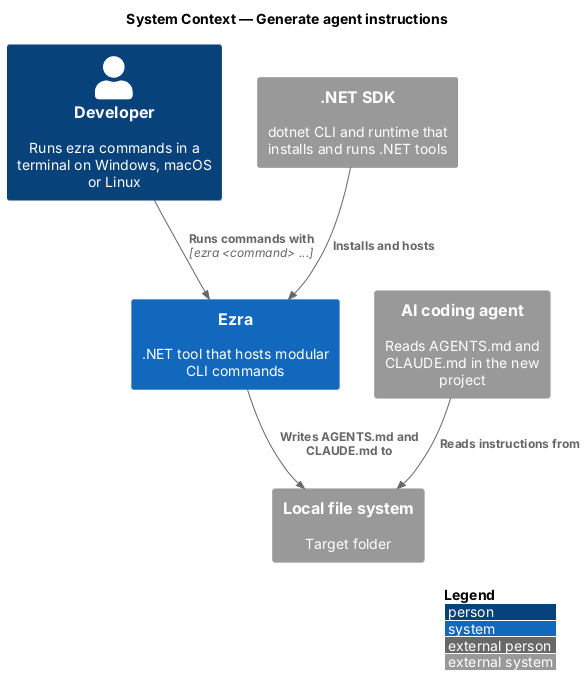
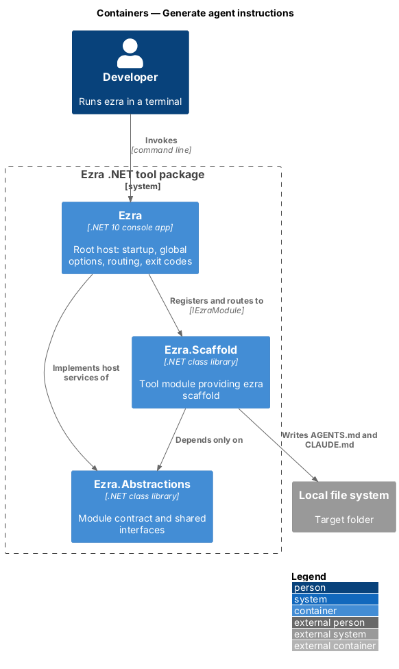
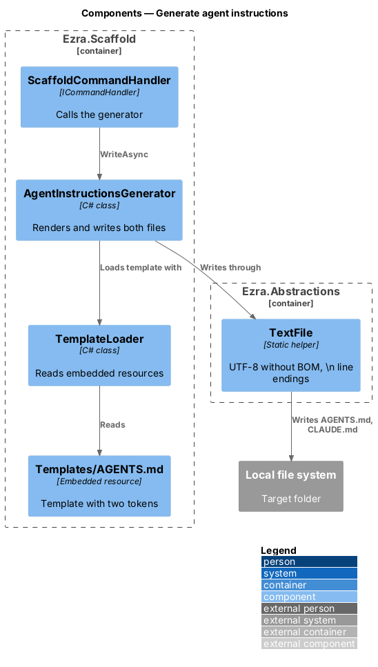
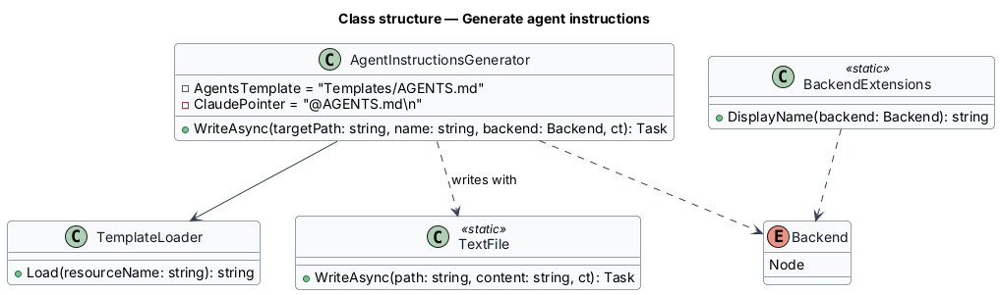
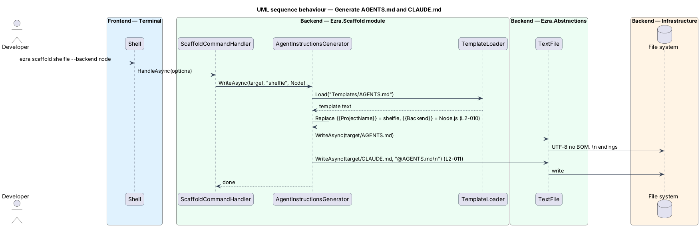

# Generate agent instructions

## Overview

AI coding agents read a project's instruction files before they work. `AGENTS.md` is the shared instruction file; `CLAUDE.md` is the file Claude Code reads, and here it only points to `AGENTS.md` so both agents follow one source.

- **agent instructions** — `AGENTS.md` at the project root: project heading, tech stack, and engineering rules
- **standard rules** — project-independent sections copied into every scaffolded project: "Scope, Simplicity, and Zero-Waste Engineering", "Incremental Implementation and ATDD" and "Never write architecture tests"
- **template** — embedded resource in `Ezra.Scaffold` from which `AGENTS.md` is rendered

This feature renders the template for the chosen name and backend and writes both files into the target folder.

## Description

- **`Templates/AGENTS.md`** — embedded resource (`<EmbeddedResource>` in `Ezra.Scaffold.csproj`). It contains `# {{ProjectName}}`, a `## Tech stack` section with `- **Backend:** {{Backend}}`, and the three standard rule sections verbatim from Ezra's own `AGENTS.md`.
- **`TemplateLoader`** — reads an embedded resource by name from the `Ezra.Scaffold` assembly as a string.
- **`AgentInstructionsGenerator`** — `WriteAsync(targetPath, name, backend, ct)`. It replaces `{{ProjectName}}` with `name` and `{{Backend}}` with the backend's display name (`Node.js`). It writes `AGENTS.md`, then writes `CLAUDE.md` with the exact content `@AGENTS.md\n`. Both writes go through `TextFile.WriteAsync`, so output is UTF-8 without BOM with `\n` line endings (L2-002).
- **Token replacement** — plain `string.Replace` on two fixed tokens. The project name is already restricted by `ProjectNameValidator` (L2-013), so it cannot inject Markdown structure beyond its own characters.
- **Overwrite** — under `--force`, both files are replaced. Without `--force`, the target folder is new or empty, so no file exists to overwrite.

## Requirements

The feature realizes the following level-2 (L2) requirements. Each L2 requirement refines a level-1 (L1) requirement, cited by identifier.

| L2 ID | Refines (L1) | Requirement |
|-------|--------------|-------------|
| `L2-010` | `L1-005` | The scaffolded `AGENTS.md` shall start with a `# <name>` heading, include a `## Tech stack` section naming the chosen backend, and include the standard, project-independent engineering rules. The template shall ship embedded in the `Ezra.Scaffold` assembly. |
| `L2-011` | `L1-005` | The scaffolded `CLAUDE.md` shall contain only a pointer to `AGENTS.md`. |

## Diagrams

### System context

The scaffold writes agent instruction files that AI coding agents later read in the new project.

### Containers

The template ships inside the `Ezra.Scaffold` assembly, so generation needs no network or external files.

### Components

`AgentInstructionsGenerator` loads the embedded template, fills two tokens and writes both files through `TextFile`.

### Class structure

`AgentInstructionsGenerator` depends on `TemplateLoader` and the static `TextFile` writer, and reads the backend display name from `Backend`.

### Behaviour — generate AGENTS.md and CLAUDE.md

The generator renders the embedded template for the project name and backend, then writes the pointer file.

