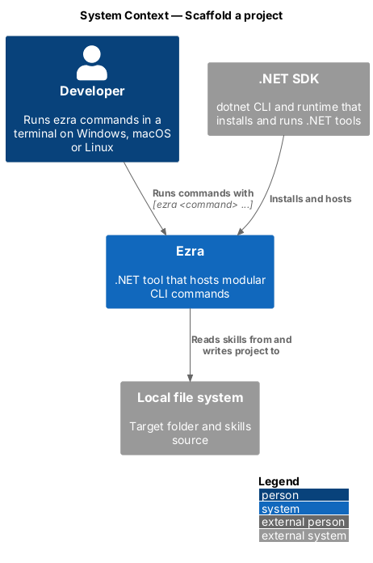
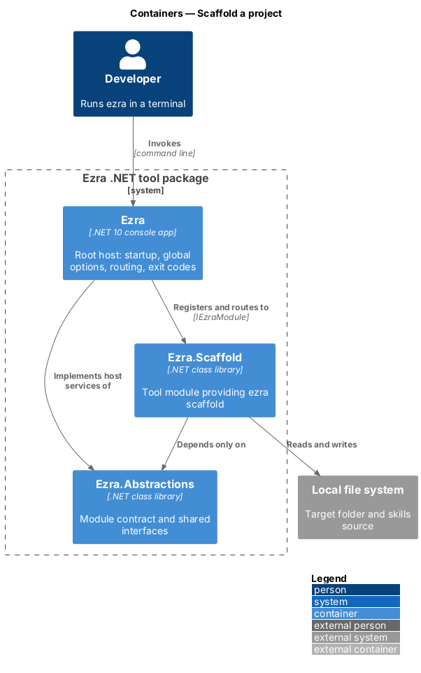
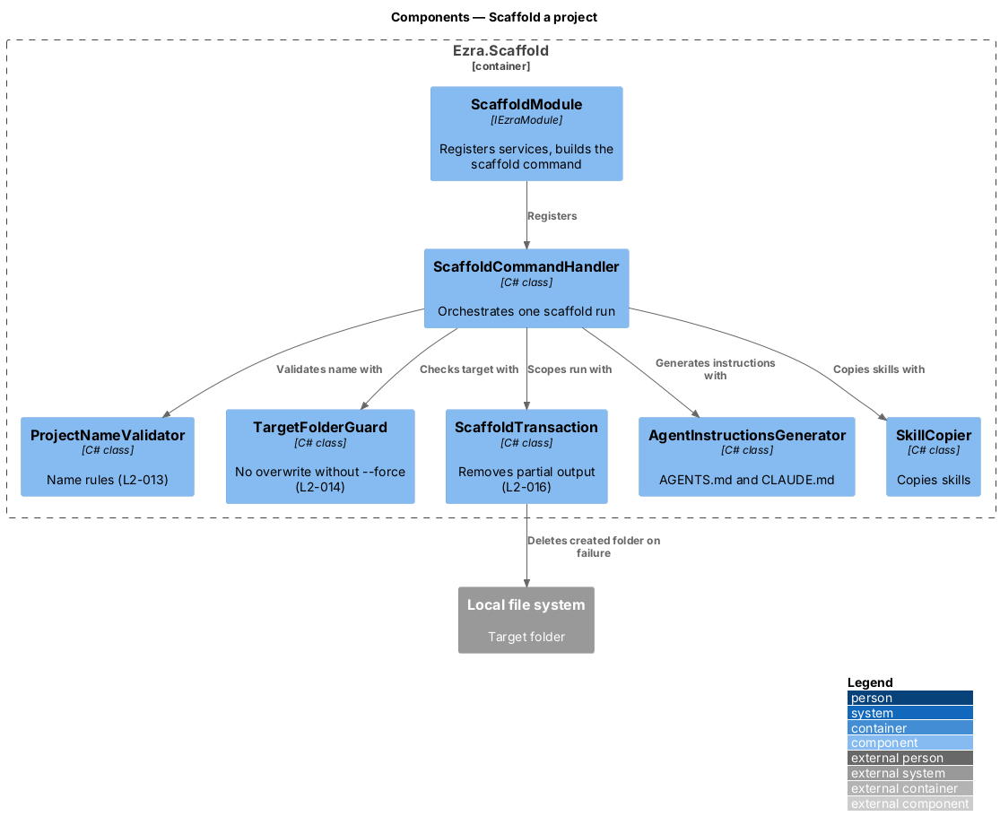
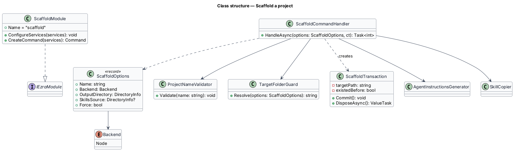
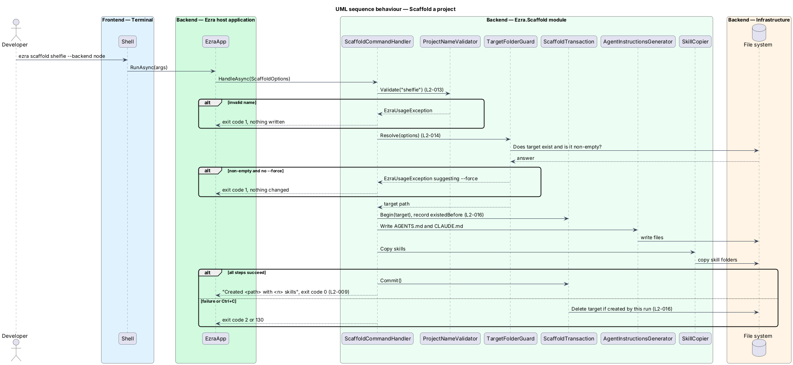

# Scaffold a project

## Overview

`Ezra.Scaffold` is the first tool module. Its command, `ezra scaffold <name>`, creates a new project folder prepared for AI-agent-assisted development: agent instructions plus the developer's locally installed skills.

- **target folder** — folder the scaffold writes to, `<output>/<name>`
- **backend** — server-side technology the new project uses; `node` (Node.js) is the only value in this release
- **generated files** — `AGENTS.md`, `CLAUDE.md`, and the skill folders under `.agents/skills/` and `.claude/skills/`

This feature owns the command itself: its options, name validation, the no-overwrite rule, and the guarantee that a failed run leaves nothing half-built. The content of the generated files belongs to generate-agent-instructions and copy-skills.

## Description

- **`ScaffoldModule`** — implements `IEzraModule` with `Name = "scaffold"`. It registers the services below as transients and builds the command.
- **`ScaffoldCommand`** — builds the `scaffold` `Command`:
  - `Argument<string> name` — the project name.
  - `Option<string> --backend` — `AcceptOnlyFromAmong("node")`. Whether it is required or defaults to `node` is `<TO SUPPLY>`.
  - `Option<DirectoryInfo> --output` — defaults to the current directory.
  - `Option<DirectoryInfo> --skills-source` — overrides the default skills folder.
  - `Option<bool> --force` — allows writing into a non-empty target folder.
- **`ScaffoldOptions`** — record bound from the parse result: `Name`, `Backend`, `OutputDirectory`, `SkillsSource`, `Force`.
- **`Backend`** — enum with one member, `Node`. Its display name is `Node.js`.
- **`ScaffoldCommandHandler`** — is resolved from the container only when `scaffold` runs. `HandleAsync(ScaffoldOptions, ct)` returns the exit code. It validates, guards, opens a transaction, generates instructions, copies skills, commits, and prints `Created <path> with <n> skills`.
- **`ProjectNameValidator`** — checks the name against `^[A-Za-z0-9_][A-Za-z0-9_.-]{0,99}$`. It rejects Windows reserved device names (`CON`, `PRN`, `AUX`, `NUL`, `COM1`–`COM9`, `LPT1`–`LPT9`, case-insensitive, with or without an extension). It throws `EzraUsageException` explaining the rule (L2-013).
- **`TargetFolderGuard`** — resolves `Path.GetFullPath(Path.Combine(output, name))`. If the folder exists, is not empty, and `--force` is absent, it throws `EzraUsageException` suggesting `--force` (L2-014).
- **`ScaffoldTransaction`** — `IAsyncDisposable`. It records whether the target folder existed before the run. `Commit()` marks success. Disposal without commit deletes the target folder only if the run created it (L2-016).
- **`--force` semantics** — the generators overwrite `AGENTS.md` and `CLAUDE.md`. `SkillCopier` replaces each copied skill folder. Every other file in the target folder is left untouched (L2-014 criterion 2).

## Requirements

The feature realizes the following level-2 (L2) requirements. Each L2 requirement refines a level-1 (L1) requirement, cited by identifier.

| L2 ID | Refines (L1) | Requirement |
|-------|--------------|-------------|
| `L2-009` | `L1-005` | The `Ezra.Scaffold` module shall provide `ezra scaffold <name> [--backend <backend>] [--output <dir>] [--skills-source <dir>] [--force]`. It creates the folder `<output>/<name>`. `--backend` accepts `node` in this release. |
| `L2-013` | `L1-006` | `<name>` shall be 1–100 characters of letters, digits, `-`, `_` and `.`, shall not start with `.` or `-`, and shall not be a reserved device name on Windows. |
| `L2-014` | `L1-006` | The scaffold shall refuse to write into an existing non-empty target folder unless `--force` is passed. With `--force`, only the files Ezra generates are replaced; other files are left untouched. |
| `L2-016` | `L1-006` | A scaffold that fails or is cancelled part-way shall not leave a partially created project behind in a folder that did not exist before the command ran. |

## Diagrams

### System context

The developer runs `ezra scaffold` and gets a new project folder on the local file system.

### Containers

The host routes `scaffold` to the `Ezra.Scaffold` module, which writes to the file system.

### Components

`ScaffoldCommandHandler` orchestrates validation, the target-folder guard, the transaction and the two content producers.

### Class structure

The handler depends on each step's class; `ScaffoldOptions` carries the parsed input; `ScaffoldTransaction` scopes the run.

### Behaviour — scaffold a project

The handler validates before it writes anything, then produces all files inside one transaction that removes a newly created folder if any step fails or is cancelled.

